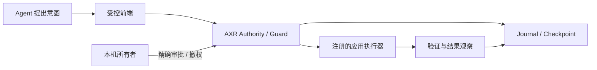

# Stellaria AXR SDK

**为 Agent 应用提供可授权、可撤销、可追溯的执行基础设施。**

[English](README.en.md) · [快速集成](docs/INTEGRATION.md) · [安全架构](SECURITY_ARCHITECTURE.md) ·
[双授权](LICENSES.md) · [参与贡献](CONTRIBUTING.md)

Stellaria AXR（Agent eXecution Runtime）把 Agent 提出的行动，转换为受明确权限约束的执行事务。
它为产品团队提供 C++20 可信核心、Python 编排接口与 macOS / Windows 平台原语，统一处理
**谁可以操作什么、为哪个目的、可以披露给谁、何时失效，以及执行结果是否确定**。

AXR 不绑定某个模型、聊天客户端或业务数据库。你保留应用和 Agent 的产品设计，
由 AXR 承担注册操作的权限、事务与审计机制；具体应用的身份核对和执行适配仍由集成方实现。

## 可以用它构建什么

- **桌面 Agent 助手**：区分数据读取、模型披露与外部写入，让权限变化回到本机所有者确认。
- **受控工具与 MCP 接入**：将已注册的操作映射到精确资源、用途和短时执行许可。
- **文件与内容工作流**：保留输入来源与数据分类，隔离内容处理，约束派生结果的使用范围。
- **本地执行服务**：分离不可信 Agent、受控前端、所有者控制面和实际执行器。

## 核心能力

| 模块 | 解决的问题 |
| --- | --- |
| **Guard** | 按主体、资源、操作、目的、期限、次数和数据分类判定授权；支持撤权与精确意图 |
| **Execution Transaction** | 绑定本次行动、执行前复核、持久化执行认领，明确处理完成与不确定状态 |
| **Provenance** | 将外部输入保持为不可信来源，分别约束读取与向模型/外部目的地披露 |
| **Journal & Checkpoint** | 加密有期限的内容记录、验证审计链，并接入受保护检查点 |
| **Authority & Owner** | 使用受认证通信，将权限服务与模型隔离；所有者审批不作为 Agent 工具暴露 |
| **Platform primitives** | 提供进程约束、原生身份、系统密钥存储和平台所有者认证接线 |



外部提交结果不确定时进入 **Unknown**，禁止自动重试。数据库观察、外部服务接受和最终送达
是不同证据；AXR 不把本地记录包装成外部服务的 exactly-once 保证。

## 开始集成

需要 **CMake 3.24+、C++20 编译器、OpenSSL 3+、SQLite3**。
Python 绑定需要 **Python 3.12+**。macOS 平台组件还需要 Swift 工具链。
nlohmann/json 3.12 可由环境提供；缺失时下载固定版本，并校验 SHA-256。

```sh
git clone https://github.com/Stellaria-Studio/Stellaria-AXR-SDK.git
cd Stellaria-AXR-SDK
cmake -S . -B .local-build/dev -DCMAKE_BUILD_TYPE=Release
cmake --build .local-build/dev --parallel 4
ctest --test-dir .local-build/dev --output-on-failure
cmake --install .local-build/dev --prefix /your/sdk/prefix
```

在独立的 CMake 消费工程中：

```cmake
find_package(StellariaAXR 1 CONFIG REQUIRED)
target_link_libraries(your_application PRIVATE Stellaria::AXR)
```

```cpp
#include <axr/Core.hpp>
using namespace Stellaria::AXR;

ValidateAction(proposedAction);
auto intent = IntentSeal(proposedAction);
// 所有者控制面提供授权；Agent 不持有签发密钥。
auto reservation = guard.Consume(proposedAction, Now());
guard.Revalidate(proposedAction, reservation[0], reservation[1], Now());
// 在注册操作实际提交前再次复核；按真实观察记录结果。
```

Python：

```sh
python -m pip install .
python examples/propose.py
```

示例只生成合成意图，不发放权限、不访问账号、不触发系统认证。
[完整构建与集成指南](docs/INTEGRATION.md)包含依赖、Windows/vcpkg、正式构建和应用接线。

## 支持范围与验证

| 层级 | 当前范围 |
| --- | --- |
| C++ 核心 | C++20、密码学、策略、事务、审计与进程原语；独立 CMake 构建/安装 |
| Python | 原生绑定和编排；开发夹具与正式配置分离 |
| macOS | Swift / 系统认证 / 密钥与签名原语；具体能力取决于系统授权和部署 |
| Windows | Hello、受保护安装、进程/IPC 与 AppContainer 接线；硬件能力另行验证 |
| Linux | 核心与 Python 合成验证；不提供等同于 macOS/Windows 的完整所有者部署能力 |

这是 **Gen1 开发版本**，尚不承诺稳定 ABI、多日无人值守或任意应用的生产准入。
当前平台部署代码保留已发布微信集成的兼容 profile；它不是通用一键应用安装器。
微信数据库、联系人、发送逻辑、MCP 产品界面和任何个人数据均不随本 SDK 分发。
详细证据和限制见 [VALIDATION.md](docs/VALIDATION.md)。

## 授权与商业合作

SDK 自有代码提供两条独立授权路径：

**GNU AGPL v3 only** 或 **Stellaria Commercial License 1.0**。

AGPL 路径允许符合其条件的商业使用。需要专有集成、闭源修改、OEM、再分发或其他不同权利时，
可与维护方洽谈 SCL 专项协议；公开的 SCL 通用文本本身不自动授予这些权利。
第三方组件保留各自许可证。完整边界见 [LICENSES.md](LICENSES.md)。

贡献采用 [Stellaria CLA 1.0](legal/Stellaria-CLA-1.0.md)，经有效签署与具体接受记录落实，
不是通过普通勾选自动转移权利。[CONTRIBUTING.md](CONTRIBUTING.md)列出签署、来源说明与审查流程。

## 安全边界

AXR 约束已注册、经其控制面执行的能力。具有同用户任意 shell、调试或密钥库权限的进程，
不会因为安装 SDK 就被自动隔离。集成方必须建立真实 OS 强制边界，并正确实现应用执行器。
审计链不能单独证明外部送达或检测完整旧快照回滚；TTL 也不能强迫外部模型遗忘已披露信息。

发现漏洞请使用 [私密报告流程](SECURITY.md)，不要公开凭据或真实用户数据。

由 **Stellaria Studio** 维护。源码来源和署名记录见 [SOURCE_ORIGIN.md](SOURCE_ORIGIN.md)。
